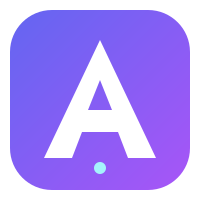
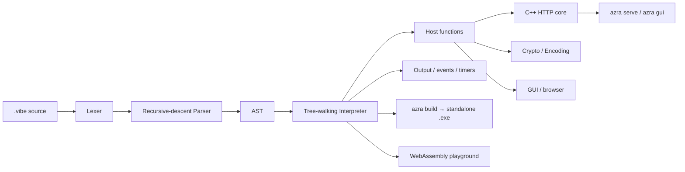

<div align="center">



# Azra <code>.vibe</code>

**A zero-bracket, plain-English programming language for apps, games, backends and GUIs.**

[](https://github.com/11nawid/azravibe.vibe/actions/workflows/ci.yml)
[](LICENSE)
[](Cargo.toml)
[](https://azravibe.com/vibe)

**[🌐 Website & Playground](https://azravibe.com/vibe)** · **[⭐ GitHub](https://github.com/11nawid/azravibe.vibe)** · **[📸 Instagram](https://www.instagram.com/1n1.nawid/)**

</div>

---

## ✨ Why Azra?

| | |
|---|---|
| **No brackets** | No `{}`, `[]` or `()`. Blocks are `:` + 4 spaces. |
| **English syntax** | `set health to 100`, `give back value`, `when player touches lava_block:` |
| **Batteries included** | 36+ standard-library modules, HTTP server, GUI, crypto, SQL-like queries |
| **Runs anywhere** | CLI, REPL, embedded in Rust, WebAssembly playground, standalone `.exe` |
| **Game-ready** | vec3 math, physics-friendly numerics, mock engine objects and events |

## ⚡ 30-second tour

```vibe
note: everything is plain English — no brackets anywhere
set inventory to "sword", "shield", "potion"
make rounded_box as lava_block
set lava_block.color to "red"

define heal with target, amount:
    add amount to target.health
    give back target.health

if first item of inventory equals "sword":
    say "Equipped!", pi, dot of vec3 1, 0, 0 and vec3 0, 1, 0
otherwise:
    warn "Nothing equipped."

when player touches lava_block:
    say "Game over!"
```

```bash
cargo run -- run examples/hello.vibe
```

## 🧩 Architecture



## 🚀 Quick start

```bash
git clone https://github.com/11nawid/azravibe.vibe.git
cd azravibe.vibe
cargo build --release

cargo run -- run examples/hello.vibe       # execute a script
cargo run -- check examples/game_demo.vibe # syntax check
cargo run -- repl                          # interactive interpreter
cargo run -- eval 'say "hi from Azra"'
cargo test                                 # full test suite
```

> The CLI also accepts `azra script.vibe` directly.

<details>
<summary><b>🛠 CLI commands</b></summary>

| Command | Purpose |
|---|---|
| `azra run` / `azra check` / `azra eval` | Execute, validate or evaluate a snippet |
| `azra repl` / bare `azra` | Colored interactive shell (`:help`, `:vars`, `:reset`) |
| `azra init`, `azra pkg ...` | Manifests, local registry, lockfile, dependencies |
| `azra test [path]` | Run in-language `test "name":` blocks |
| `azra fmt [--check]` | 4-space formatter |
| `azra serve app.vibe --port 8080` | HTTP backend framework |
| `azra gui-native app.vibe` | Native Win32 GUI (no browser) |
| `azra gui app.vibe --port 8080` | Browser GUI + auto-open |
| `azra build app.vibe --out app.exe` | Standalone executable |
| `azra-lsp` | Language server (VS Code / Neovim clients included) |

</details>

## 🧠 The language at a glance

<details>
<summary><b>Core syntax, operators and semantics</b></summary>

- Blocks: `if`, `otherwise if`, `otherwise`, `repeat`, `for each`, `while`, `define`, `when`, `try`.
- Math: `+ - * / modulo power`, `sqrt abs round floor ceil`, `min of`, `max of`, `clamp ... between ... and ...`, `lerp ... to ... by ...`.
- Trig/constants: `pi`, `e`, `sin cos tan asin acos atan atan2`, degrees ↔ radians.
- Logs: `log of x`, `log base b of x`, `log10 of x`, `exp of x`.
- Vectors: `vec3`, `dot of`, `cross of`, `magnitude of`, `normalize`, `distance between`, `angle between`.
- Collections: lists, maps, `set key "k" of m to v`, `item 2 of xs`, `sort`, `reverse`, `clear`.
- Comments: `note:`, `#`, `/* ... */`. Interpolation: `"HP: {player.health}"`.
- Integer division truncates; `modulo` is Euclidean; NaN comparisons are errors; overflow is checked.

Full reference: [`docs/language.vibetxt`](docs/language.vibetxt).
</details>

## 📚 Standard library

<details>
<summary><b>36 modules shipped in <code>std/</code></b></summary>

| Area | Modules |
|---|---|
| Math & data | `math`, `vec3`, `random`, `query`, `json`, `collections`, `string` |
| Apps & infra | `config`, `log`, `template`, `auth`, `orm`, `queue`, `cli`, `metrics`, `i18n`, `upload`, `plugin`, `validate` |
| Web | `http`, `db`, `session`, `middleware`, `ratelimit`, `cache`, `worker`, `mail`, `report`, `chart`, `search`, `schedule`, `state`, `eventbus`, `httpclient`, `security`, `gui` |
| Testing & I/O | `testing`, `io` |

Use them with `use "std/math"` or `use "std/http"`. Installed packages load with `use "package-name/module"`.
</details>

## 🌐 Backend, GUI & standalone apps

```vibe
note: examples/server.vibe — a real backend in Azra
use "std/http"
use "std/db"

when http request with req:
    if req.path equals "/health":
        send_json with req, 200, "ok"
    otherwise:
        send_text with req, 404, "not found"
```

```bash
azra serve examples/server.vibe --port 8080
azra gui-native examples/native_gui.vibe --title "Azra GUI"   # native Win32, no browser
azra gui examples/gui.vibe --port 8080                        # optional browser GUI
azra build examples/hello.vibe --name myapp --out myapp.exe
```

The HTTP core is C++ (`native/azra_net.cpp`) and the **native GUI** core is C++
(`native/azra_gui.cpp`), both bridged to Rust. `std/nativegui` creates Win32
labels, buttons and edit boxes, and `when gui event with event:` handles clicks
without any browser. `azra build` compiles a tiny Rust crate that embeds the
`.vibe` script into one executable.

## 🗺 Roadmap

The long-term goal is **500 complete frameworks/libraries**. Progress is tracked in
[`CHANGELOG.md`](CHANGELOG.md) and pushed in reviewed rounds.

- [x] Core language, REPL, packages, LSP, formatter, WASM playground
- [x] C++ HTTP server/client, backend framework, JSON table store
- [x] Round 1: config, logging, templates, auth, ORM, jobs, CLI, metrics, i18n, uploads, plugins, validation, GUI, exe builder
- [x] Round 2: sessions, middleware, rate limiting, cache, workers, mail, reports, charts, search, scheduling, state machines, event bus, REST client, security
- [x] Round 3: native Win32 GUI, statistics, pagination, cookies, tweening, geometry, matrices, graphs, pathfinding, physics
- [ ] Rounds 4–N: 500 frameworks total — coming continuously

## 🤝 Support the developer

If Azra helps you, please **star the repo**, share it, open issues, or just say hello.

<p align="center">
  <a href="https://www.instagram.com/1n1.nawid/">
    
  </a>
</p>

**DM me on Instagram [@1n1.nawid](https://www.instagram.com/1n1.nawid/)** for questions, ideas,
collaboration or to support the project. Contributions are currently made by the owner and the
AI assistant; see [`CONTRIBUTING.md`](CONTRIBUTING.md) for rules and commit conventions.

## 📄 License

MIT — see [`LICENSE`](LICENSE). Built with Rust, C++ and Azra itself.
